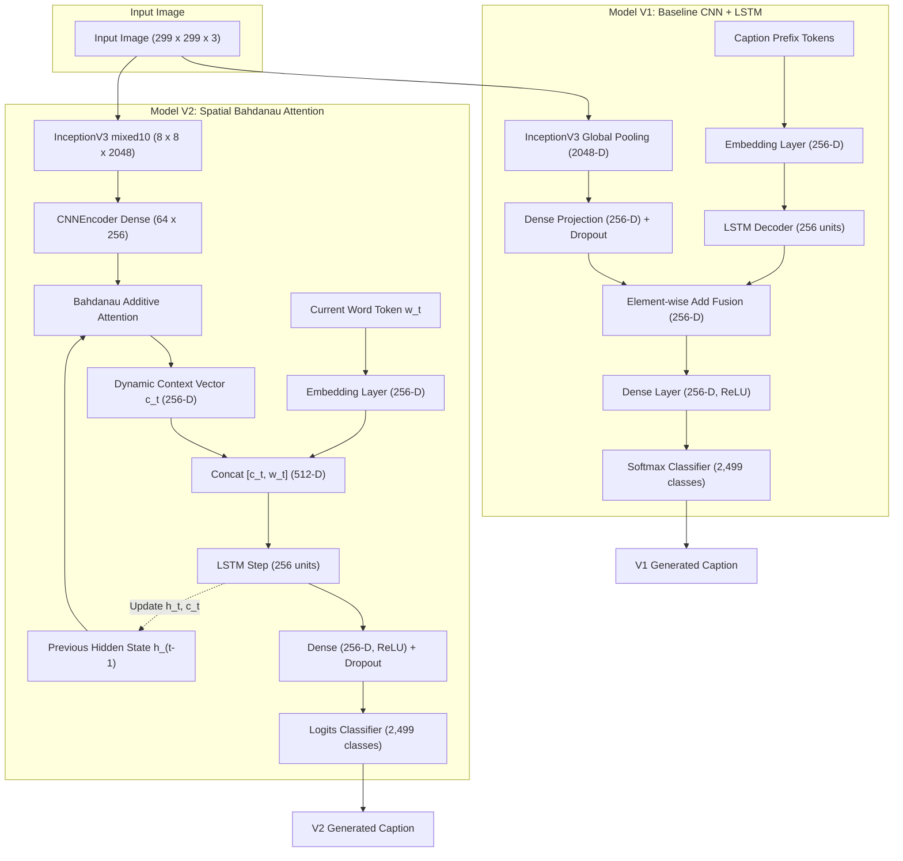

# Image Captioning: CNN–LSTM vs. Spatial Attention

[](https://www.python.org/)
[](https://www.tensorflow.org/)
[](https://keras.io/)
[](https://streamlit.io/)
[](https://github.com/atulkumar-ds/Image-Captioning)
[](https://opensource.org/licenses/MIT)

A research-grade, reproducible deep learning project investigating the progression of vision-language architectures for automated image captioning on the **Flickr8k** benchmark.

This project implements, evaluates, and compares two distinct generative paradigms:
1. **Model V1 (Baseline):** InceptionV3 global average pooling with an additive feature-fusion LSTM decoder.
2. **Model V2 (Spatial Attention):** InceptionV3 spatial feature maps ($8 \times 8 \times 2048$) with Bahdanau additive attention and an autoregressive recurrent decoder.
3. **CaptionLab:** A unified, real-time side-by-side comparative Streamlit web application running both trained models simultaneously on identical input visual features.

---

## 📑 Table of Contents

- [Project Roadmap](#-project-roadmap)
- [CaptionLab: Unified Comparison Application](#-captionlab-unified-comparison-application)
- [Model Architectures](#-model-architectures)
  - [Architectural Comparison Matrix](#architectural-comparison-matrix)
  - [End-to-End Pipeline Diagram](#end-to-end-pipeline-diagram)
  - [Model V1: Baseline CNN + LSTM](#model-v1-baseline-cnn--lstm)
  - [Model V2: Spatial Bahdanau Attention](#model-v2-spatial-bahdanau-attention)
- [Dataset Partitioning & Anti-Leak Protocol](#-dataset-partitioning--anti-leak-protocol)
- [Experimental Results & Evaluation](#-experimental-results--evaluation)
  - [Corpus BLEU Benchmark Results](#corpus-bleu-benchmark-results)
  - [Loss Semantics & Metric Interpretation](#loss-semantics--metric-interpretation)
- [Artifact Registry & Checkpoint Resolution](#-artifact-registry--checkpoint-resolution)
- [Installation & Quickstart Guide](#-installation--quickstart-guide)
- [CLI Workflow: Training, Evaluation & Inference](#-cli-workflow-training-evaluation--inference)
- [Repository Structure](#-repository-structure)
- [Automated Test Suite](#-automated-test-suite)
- [Troubleshooting & FAQ](#-troubleshooting--faq)
- [Author & Acknowledgments](#-author--acknowledgments)

---

## 🚀 Project Roadmap

| Phase | Architecture | Visual Encoder | Language Decoder | Attention Mechanism | Status |
|:---:|:---|:---|:---|:---:|:---:|
| **V1** | **CNN + LSTM Baseline** | InceptionV3 (Global 2048-D) | LSTM (256 units) | None | ✅ **Complete** |
| **V2** | **Spatial Attention** | InceptionV3 ($8 \times 8 \times 2048$) | LSTM (256 units) | Bahdanau Additive | ✅ **Complete** |
| **App** | **CaptionLab Web App** | Dual InceptionV3 Pipelines | Dual Decoders | Comparative Analysis | ✅ **Complete** |
| **V3** | **Transformer Decoder** | InceptionV3 / EfficientNet | Transformer Decoder (Multi-Head) | Scaled Dot-Product | ⏳ Planned |
| **V4** | **Vision Transformer (ViT)** | ViT Patch Encoder ($16 \times 16$) | Transformer Decoder | Cross-Attention | ⏳ Planned |
| **V5** | **Multimodal Pretraining** | Pretrained Contrastive ViT | Autoregressive LLM | Cross-Modal Alignment | ⏳ Planned |

---

## 🔬 CaptionLab: Unified Comparison Application

**CaptionLab** (`comparison_app.py`) is a unified, research-oriented Streamlit web application designed to benchmark Model V1 and Model V2 side by side on identical uploaded images in real time.

```
+-----------------------------------------------------------------------------+
|                                🔬 CaptionLab                                |
|             Unified Comparative Evaluation of Vision-Language Models        |
+-----------------------------------------------------------------------------+
|  [ 📤 Upload Input Image: drag-and-drop JPG, JPEG, or PNG ]                |
|  Image: sample.jpg | 299x299 px | 84.2 KB                                   |
|  [ 🚀 Compare Models ]                                                      |
+--------------------------------------+--------------------------------------+
|          V1 BASELINE CARD            |          V2 ATTENTION CARD           |
| Architecture: InceptionV3 + LSTM     | Architecture: Spatial Attn + LSTM    |
| Checkpoint: best_caption_model.keras | Weights: v2_attention.weights.h5     |
| Caption:                             | Caption:                             |
| "a man in a red shirt is standing"   | "a man in a red shirt standing by"   |
| Latency: 3106.6 ms (3.107 s)         | Latency: 478.8 ms (0.479 s)          |
+--------------------------------------+--------------------------------------+
|                      📊 Comparative Insights & Latency                      |
| • Speed Delta: V2 completed 6.49x faster (2627.8 ms delta)                  |
| • Vocabulary Overlap (Jaccard): 46.7%                                       |
| • Shared Tokens: ["a", "in", "is", "man", "red", "shirt", "standing"]       |
| • [ 📄 Export JSON Report ]          [ 📝 Export TXT Summary ]              |
+-----------------------------------------------------------------------------+
```

### Verified Application Capabilities

- **Single-Upload Dual-Inference:** Upload an image once; both models evaluate against identical image pixels.
- **Image Inspection:** Automatically displays image resolution, file size, color space, and a visual preview.
- **Controlled Execution:** Inference is triggered explicitly via **Compare Models**, preventing unneeded computations during file selection.
- **Isolated Error Boundaries:** Each model initializes and executes in an independent error boundary. If one model fails, the other model continues to execute, and exact diagnostics are presented.
- **High-Precision Latency Measurement:** Measures end-to-end feature extraction and decoding duration using Python monotonic timers (`time.perf_counter()`).
- **Faithful Token Display:** Handles special sequence markers cleanly (filters `<start>`, `<end>`, and `<pad>`). Out-of-vocabulary words (`<unk>`) are preserved faithfully as predicted by the model, accompanied by an explanatory notice.
- **Token Alignment & Similarity Analysis:** Dynamically calculates token-level set intersection, V1-exclusive words, V2-exclusive words, and Jaccard vocabulary similarity from generated strings.
- **Audit Reports:** Generates downloadable timestamped audit reports in both structured **JSON** and plain **TXT** formats.
- **Zero In-Memory Duplication:** Uses `@st.cache_resource` so that heavy model weights, InceptionV3 encoders, and tokenizers are loaded once per process and reused across subsequent runs.

> [!TIP]
> **Capturing Application Screenshots for Documentation:**  
> To save visual assets for presentations or articles, create a `docs/` folder in the repository root and store your application captures (e.g., `docs/captionlab_overview.png`). CaptionLab is styled with a modern dark theme (`#0d1117`) suitable for direct inclusion in technical portfolios.

---

## 🏛️ Model Architectures

### Architectural Comparison Matrix

| Specification | Model V1 (Baseline CNN + LSTM) | Model V2 (Spatial Bahdanau Attention) |
| :--- | :--- | :--- |
| **Visual Backbone** | InceptionV3 (ImageNet weights, frozen) | InceptionV3 `mixed10` (ImageNet weights, frozen) |
| **Visual Output Shape** | Global average pooled 1D vector: `(2048,)` | Spatial 2D grid: $8 \times 8 \times 2048 \rightarrow$ reshaped to `(64, 2048)` |
| **Encoder Projection** | `Dense(256, activation="relu")` + `Dropout(0.5)` | `CNNEncoder`: `Dense(256, activation="relu")` over 64 vectors |
| **Attention Mechanism** | *None* (global image context) | Bahdanau Additive Attention: $W_1 h_t + W_2 s_i \rightarrow \tanh \rightarrow V$ |
| **Attention Context** | N/A | $\sum_{i=1}^{64} \alpha_{t,i} f_i \in \mathbb{R}^{256}$ |
| **Language Decoder** | `LSTM(256)` | `RNNDecoder`: `LSTM(256, return_sequences=True, return_state=True)` |
| **State Initialization** | Element-wise `Add([image_feat, text_feat])` | Step-by-step state recurrence: `[hidden_state, cell_state]` |
| **Decoder Input** | Full prefix word indices `(max_length,)` | Concatenated vector: `[context_vector (256-D), embedding (256-D)]` (512-D) |
| **Vocabulary Size** | 2,499 tokens (min frequency $\ge 5$) | 2,499 tokens (min frequency $\ge 5$) |
| **Max Sequence Length** | 37 tokens | 37 tokens |
| **Output Layer** | `Dense(2499, activation="softmax")` | `Dense(2499)` linear logits (softmax via loss / argmax) |
| **Training Loss Objective** | Categorical Cross-Entropy per valid prefix-target | Token-normalized masked Sparse Categorical Cross-Entropy |
| **Checkpoint Format** | Whole-model Keras archive (`.keras`, 28.8 MB) | Layer weights archive (`.weights.h5`, 11.2 MB) |

---

### End-to-End Pipeline Diagram



---

### Model V1: Baseline CNN + LSTM

The baseline architecture separates feature extraction from sequence decoding through late multimodal fusion:
1. **Visual Processing:** Input images are resized to $299 \times 299$ and preprocessed with InceptionV3 normalization ($[-1, 1]$). Features are extracted using InceptionV3 with global average pooling, producing a 2048-dimensional feature vector.
2. **Visual Feature Projection:** The 2048-D vector passes through `Dropout(0.5)` and a linear projection `Dense(256, activation="relu")` to match the decoder's hidden dimensionality.
3. **Caption Embedding & Recurrence:** The caption prefix is mapped through `Embedding(input_dim=2499, output_dim=256, mask_zero=True)`, regularized with `Dropout(0.5)`, and processed through an `LSTM(256)`.
4. **Multimodal Fusion:** The projected image representation and LSTM sequence summary are fused via element-wise addition (`Add`), passed through a joint representation `Dense(256, activation="relu")`, and projected to vocabulary logits via `Dense(2499, activation="softmax")`.
5. **Inference Strategy:** Decoding starts with the `<start>` token. At each timestep, the current prefix is fed through the network, the argmax token is appended, and generation terminates when `<end>` is emitted or the sequence reaches 37 tokens.

---

### Model V2: Spatial Bahdanau Attention

The attention-based architecture retains spatial visual features, allowing the decoder to selectively focus on different image regions at each generation step:
1. **Spatial Visual Extraction:** InceptionV3 is tapped at the `mixed10` layer without spatial pooling, outputting an $8 \times 8 \times 2048$ feature map reshaped into $64$ spatial vectors of dimension $2048$.
2. **Encoder Projection:** `CNNEncoder` projects each of the 64 spatial vectors through a shared linear layer:
   $$\mathbf{f}_i = \text{ReLU}(\mathbf{W}_{enc} \mathbf{x}_i + \mathbf{b}_{enc}) \quad \forall i \in \{1, \dots, 64\}, \quad \mathbf{f}_i \in \mathbb{R}^{256}$$
3. **Bahdanau Additive Attention:** At decode step $t$, the attention score $e_{t,i}$ for each spatial position $i$ is computed from the previous decoder hidden state $\mathbf{h}_{t-1}$ and spatial features $\mathbf{f}_i$:
   $$e_{t,i} = \mathbf{V}^\top \tanh(\mathbf{W}_1 \mathbf{f}_i + \mathbf{W}_2 \mathbf{h}_{t-1})$$
   $$\alpha_{t,i} = \frac{\exp(e_{t,i})}{\sum_{j=1}^{64} \exp(e_{t,j})}$$
   $$\mathbf{c}_t = \sum_{i=1}^{64} \alpha_{t,i} \mathbf{f}_i \quad \in \mathbb{R}^{256}$$
4. **Attention-Augmented Decoder:** The context vector $\mathbf{c}_t$ is concatenated with the embedding of the current token $\mathbf{y}_t$ to form a 512-dimensional vector fed directly into the `LSTM`:
   $$\mathbf{x}_t = [\mathbf{c}_t \,;\, \mathbf{E} \mathbf{y}_t]$$
   $$(\mathbf{h}_t, \mathbf{s}_t) = \text{LSTM}(\mathbf{x}_t, (\mathbf{h}_{t-1}, \mathbf{s}_{t-1}))$$
5. **Prediction:** The LSTM output passes through `Dense(256, activation="relu")`, `Dropout(0.3)`, and linear projection `Dense(2499)` to yield word prediction logits.

---

## 📊 Dataset Partitioning & Anti-Leak Protocol

The benchmark dataset is **Flickr8k** (8,091 images, 5 crowdsourced captions per image, totaling 40,455 caption pairs).

### The Canonical Disjoint Split (`splits.json`)

To ensure leak-free evaluation, all images and captions are partitioned into a deterministic canonical split:

```
Total Flickr8k Benchmark (8,091 Images)
├── Canonical Training Split:   5,663 Images (70%)  |  28,315 Captions
├── Canonical Validation Split: 1,213 Images (15%)  |   6,065 Captions
└── Canonical Test Split:       1,215 Images (15%)  |   6,075 Captions
```

- **Partition Disjointness:** Strictly enforced by automated tests (`tests/test_evaluation.py`). Cross-partition intersection between train, val, and test is exactly **zero**.
- **Determinism:** Governed by SHA-256 partition fingerprints recorded in `splits.json` with fixed seed `42`.

> [!IMPORTANT]
> **Data Contamination Finding & Enforced Evaluation Boundaries:**
> - Historical baseline training runs used legacy 90/10 split splits (`historical_v1_split` and `historical_v2_split`).
> - **Audit Discovery:** 405 canonical test images appear in V1's historical training partition, and 1,215 canonical test images appear in V2's historical training partition. Evaluating historical checkpoints against `canonical_test` constitutes severe data contamination.
> - **Enforced Protocol:** Historical checkpoints are restricted to evaluation against their matched historical validation splits. The canonical test split (`canonical_test`) is reserved exclusively for newly trained models trained on `canonical_split["train"]`.

### Vocabulary & Preprocessing Parameters

- **Vocabulary Thresholding:** Words appearing $\ge 5$ times across the training set are retained, yielding **2,499 tokens** (including special tokens).
- **Special Tokens:**
  - `<start>`: Sequence initiation token.
  - `<end>`: Sequence termination token.
  - `<pad>`: Sequence padding token (index 0).
  - `<unk>`: Out-of-vocabulary representation for rare or unseen words.
- **Maximum Length:** Capped at **37 tokens** (accommodating 99.5% of Flickr8k captions). Longer sequences are truncated while preserving boundary tokens.

---

## 📈 Experimental Results & Evaluation

### Corpus BLEU Benchmark Results

Corpus-level BLEU evaluation computes n-gram precision across the entire test set using Papineni et al. (2002) with brevity penalty and Chen & Cherry (2014) smoothing:

| Experiment / Checkpoint | Split Evaluated | Images | BLEU-1 | BLEU-2 | BLEU-3 | BLEU-4 | Val Loss (Best) |
| :--- | :--- | :---: | :---: | :---: | :---: | :---: | :---: |
| **V2 Attention (Retrained)** | `canonical_test` | 1,215 | **0.5378** | **0.3646** | **0.2368** | **0.1526** | 3.0716 (Ep 40) |
| **V1 Baseline (Retrained)** | `canonical_val` | 1,213 | *Pending Eval* | *Pending Eval* | *Pending Eval* | *Pending Eval* | **2.9559** (Ep 7/11) |
| **V1 Baseline (Historical)** | `historical_v1_val` | 810 | 0.4830 | 0.2974 | 0.1812 | 0.1012 | 3.3313 |
| **V2 Attention (Historical)** | `historical_v2_val` | 809 | 0.4617 | 0.2798 | 0.1654 | 0.0881 | 3.4890 |

*Source verification: `V2_Attention/experiments/v2_attention_gpu_retrain_20261027/results/bleu_scores.txt` and `config.json` files.*

### Loss Semantics & Metric Interpretation

1. **Teacher Forcing vs. Autoregressive Inference:**  
   During training, the ground-truth previous token is always provided to the decoder (teacher forcing). During inference, the model must feed its own predictions back into the decoder, meaning errors compound over time. Consequently, training loss alone is not an indicator of real-world caption quality.
2. **Loss Formulation Differences:**  
   - **V1:** Evaluates categorical cross-entropy per individual prefix-target sample.
   - **V2:** Evaluates sequence-level cross-entropy dynamically masked by valid tokens ($\text{loss} = \frac{\sum \text{masked\_loss}}{\sum \text{valid\_tokens}}$), eliminating loss dilution caused by trailing padding zeros.
3. **Limits of BLEU Metrics:**  
   BLEU measures surface-level n-gram overlap against human references. It does not measure semantic adequacy or visual alignment (e.g., predicting "a canine runs across grassland" scores low BLEU against references like "a dog sprints through the park", despite being semantically accurate).

---

## 🗄️ Artifact Registry & Checkpoint Resolution

Both standalone applications and CaptionLab use deterministic path resolution with environment variable overrides:

### Checkpoint Hierarchy

```
Priority 1: Environment Variable Override (e.g., $env:V1_MODEL_PATH)
    └── Priority 2: Trained Experiment Artifacts (preferred, retrained 2026-10-27)
            └── Priority 3: Legacy models/ Directory (fallback)
```

| Model | Artifact Type | Active File Path | Size | Status |
| :--- | :--- | :--- | :---: | :---: |
| **V1** | Checkpoint | `V1_Baseline_CNN_LSTM/experiments/v1_gpu_retrain_20261027/models/best_caption_model.keras` | 28.8 MB | Tracked in Git |
| **V1** | Tokenizer | `V1_Baseline_CNN_LSTM/experiments/v1_gpu_retrain_20261027/models/tokenizer.json` | 128.5 KB | Tracked in Git |
| **V1** | Final Model | `V1_Baseline_CNN_LSTM/experiments/v1_gpu_retrain_20261027/models/final_caption_model.keras` | 28.8 MB | Tracked in Git |
| **V2** | Weights | `V2_Attention/experiments/v2_attention_gpu_retrain_20261027/models/v2_attention.weights.h5` | 11.2 MB | Tracked in Git |
| **V2** | Tokenizer | `V2_Attention/experiments/v2_attention_gpu_retrain_20261027/models/tokenizer.json` | 128.5 KB | Tracked in Git |
| **V2** | Legacy Weights | `V2_Attention/models/v2_attention.weights.h5` | 11.8 MB | Tracked in Git |

> [!NOTE]
> **Environment Variable Overrides:**  
> To test custom checkpoints without modifying code:
> - `$env:V1_MODEL_PATH = "C:\path\to\custom_v1.keras"`
> - `$env:V1_TOKENIZER_PATH = "C:\path\to\custom_tok1.json"`
> - `$env:V2_WEIGHTS_PATH = "C:\path\to\custom_v2.weights.h5"`
> - `$env:V2_TOKENIZER_PATH = "C:\path\to\custom_tok2.json"`

---

## 💻 Installation & Quickstart Guide

This project is configured to run on **native Windows (PowerShell)** without requiring WSL, Docker, or external Linux toolchains.

### Prerequisites

- **OS:** Windows 10 / 11 (64-bit)
- **Python:** 3.12 or 3.13 (64-bit)
- **Shell:** Windows PowerShell or PowerShell 7

### 1. Clone the Repository

```powershell
git clone https://github.com/atulkumar-ds/Image-Captioning.git
Set-Location "Image-Captioning"
```

### 2. Create and Activate a Virtual Environment

```powershell
python -m venv .venv
.\.venv\Scripts\Activate.ps1
```

*(If PowerShell script execution is restricted on your machine, enable it for the current process: `Set-ExecutionPolicy -Scope Process -ExecutionPolicy Bypass`)*

### 3. Install Dependencies

```powershell
python -m pip install --upgrade pip
pip install -r requirements.txt
```

> [!NOTE]
> **Hardware Acceleration on Windows:**  
> Native Windows builds of TensorFlow $\ge 2.11$ operate in **CPU mode** (TensorFlow emits an informational message on startup). Caption inference for both V1 and V2 executes reliably on CPU within 0.5–3 seconds per image. GPU training requires WSL2 (Ubuntu) with NVIDIA Container Toolkit.

### 4. Launch the Applications

#### Option A: CaptionLab Side-by-Side Comparison App (Recommended)
```powershell
python -m streamlit run comparison_app.py --server.port 8504
```
*Open your browser at `http://localhost:8504`.*

#### Option B: Standalone Model V1 Application
```powershell
streamlit run V1_Baseline_CNN_LSTM/app/app.py --server.port 8502
```
*Open your browser at `http://localhost:8502`.*

#### Option C: Standalone Model V2 Application
```powershell
streamlit run V2_Attention/app.py --server.port 8503
```
*Open your browser at `http://localhost:8503`.*

---

## 🛠️ CLI Workflow: Training, Evaluation & Inference

### 1. Single-Image CLI Inference

Run caption generation directly on a test image from PowerShell:

```powershell
# Model V1 Inference test
python V1_Baseline_CNN_LSTM/src/generate_caption.py

# Model V2 Inference test
python V2_Attention/src/generate_caption.py
```

### 2. Model Retraining on Canonical Splits

Both training pipelines support deterministic seeding, atomic history logging, and checkpoint validation:

```powershell
# Train Model V1 on Canonical Split (batch size 64, seed 42)
python V1_Baseline_CNN_LSTM/src/train.py `
    --split canonical `
    --output_dir V1_Baseline_CNN_LSTM/experiments/v1_canonical `
    --seed 42 `
    --epochs 40 `
    --batch_size 64

# Train Model V2 on Canonical Split (batch size 32, seed 42)
python V2_Attention/src/train.py `
    --split canonical `
    --output_dir V2_Attention/experiments/v2_canonical `
    --seed 42 `
    --epochs 40 `
    --batch_size 32
```

*(Use `--dry_run` to test configuration syntax and directory structures without executing training loops or modifying files.)*

### 3. Held-Out Evaluation (Corpus BLEU)

```powershell
# Evaluate Model V2 on canonical test split
python V2_Attention/src/evaluate.py `
    --split canonical_test `
    --trained_on canonical `
    --weights V2_Attention/experiments/v2_attention_gpu_retrain_20261027/models/v2_attention.weights.h5 `
    --tokenizer V2_Attention/experiments/v2_attention_gpu_retrain_20261027/models/tokenizer.json

# Evaluate Model V1 on canonical test split
python V1_Baseline_CNN_LSTM/src/bleu_score.py `
    --split canonical_test `
    --trained_on canonical `
    --model V1_Baseline_CNN_LSTM/experiments/v1_gpu_retrain_20261027/models/best_caption_model.keras `
    --tokenizer V1_Baseline_CNN_LSTM/experiments/v1_gpu_retrain_20261027/models/tokenizer.json
```

---

## 📁 Repository Structure

```text
Image-Captioning/
├── comparison_app.py               # CaptionLab unified side-by-side comparison web application
├── requirements.txt                # Unified root project dependency specification
├── splits.json                     # Canonical 70/15/15 & historical split partition manifests
├── README.md                       # Comprehensive project documentation
├── .gitignore                      # Git exclusion rules (caches, temp files, datasets)
│
├── tests/                          # Automated unit and regression test suite
│   ├── test_code_correctness.py    # Padding semantics, tensor shapes & lazy proxy tests
│   ├── test_evaluation.py          # Split disjointness, anti-leak checks & BLEU tests
│   └── test_training_semantics.py  # Text preprocessing & token-masked loss tests
│
├── V1_Baseline_CNN_LSTM/           # Version 1 Baseline Architecture
│   ├── app/
│   │   └── app.py                  # Standalone V1 Streamlit web application
│   ├── experiments/
│   │   └── v1_gpu_retrain_20261027/
│   │       ├── models/             # best_caption_model.keras, tokenizer.json
│   │       ├── plots/              # accuracy.png, loss.png
│   │       ├── config.json         # Training hyperparameters and SHA-256 fingerprints
│   │       └── history.json        # Training and validation epoch history
│   ├── models/                     # Legacy tokenizer and metadata
│   ├── src/                        # Modular source pipeline
│   │   ├── cnn_features.py         # Lazy InceptionV3 global feature extractor
│   │   ├── dataset.py              # Caption cleaning and loading utilities
│   │   ├── generate_caption.py     # Autoregressive greedy caption generator
│   │   ├── model.py                # Keras Functional API model architecture
│   │   ├── train.py                # Seeded reproducible training pipeline
│   │   └── bleu_score.py           # Corpus BLEU calculation with Papineni smoothing
│   └── requirements.txt
│
└── V2_Attention/                   # Version 2 Spatial Attention Architecture
    ├── app.py                      # Standalone V2 Streamlit web application
    ├── experiments/
    │   └── v2_attention_gpu_retrain_20261027/
    │       ├── models/             # v2_attention.weights.h5, tokenizer.json
    │       ├── plots/              # loss.png, bleu_comparison_v1_v2.png
    │       ├── results/            # bleu_scores.txt (Canonical test results)
    │       ├── config.json         # Checkpoint metadata and loss configuration
    │       └── history.json        # 40-epoch loss curves
    ├── models/                     # Legacy weights (v2_attention.weights.h5)
    ├── src/                        # Modular source pipeline
    │   ├── attention.py            # Bahdanau Additive Attention layer
    │   ├── encoder.py              # CNNEncoder dense projection layer
    │   ├── decoder.py              # RNNDecoder with LSTM and attention fusion
    │   ├── model.py                # Subclassed ImageCaptionModel
    │   ├── loss.py                 # Valid token-normalized masked cross-entropy
    │   ├── train.py                # Custom training loop with GradientTape
    │   ├── evaluate.py             # Greedy inference and BLEU evaluation suite
    │   └── generate_caption.py     # Autoregressive attention caption generator
    └── requirements.txt
```

---

## 🧪 Automated Test Suite

The repository includes test suites covering architecture shapes, sequence alignments, anti-leak split validation, and atomic file persistence:

```powershell
# Run the complete test suite
pytest tests/ -v
```

### Key Test Coverage Areas

1. **Tensor Shape Verification:** Confirms Bahdanau attention outputs context vectors of shape `(batch, 256)` and attention maps of shape `(batch, 64, 1)`.
2. **Padding & Truncation Alignment:** Verifies teacher-forcing alignment (`caption[:, :-1]` inputs match `caption[:, 1:]` targets).
3. **Lazy CNN Proxy:** Confirms InceptionV3 is not instantiated upon module import, preserving memory during test discovery.
4. **Partition Integrity & Anti-Leak Guards:** Rejects split configurations containing duplicate image IDs or cross-partition overlaps between train, val, and test.
5. **Atomic Serialization:** Verifies interrupted history writes or metadata updates do not corrupt configuration state.

---

## ❓ Troubleshooting & FAQ

### 1. PowerShell Script Execution Error
- **Symptom:** `.\.venv\Scripts\Activate.ps1 cannot be loaded because running scripts is disabled on this system.`
- **Fix:** Run `Set-ExecutionPolicy -Scope Process -ExecutionPolicy Bypass` in your PowerShell window, then reactivate.

### 2. Slow First Inference Pass
- **Symptom:** First caption generation takes 3–5 seconds, but subsequent generations take under 0.5 seconds.
- **Cause:** On initial execution, Keras loads the InceptionV3 ImageNet backbone and builds graph execution traces. Subsequent inferences run against cached warm graphs.

### 3. Checkpoint or Tokenizer FileNotFoundError
- **Symptom:** `Checkpoint not found` or `Tokenizer not found`.
- **Fix:** Confirm you are running commands from the repository root (`Image-Captioning`). Both apps dynamically resolve paths relative to their location, but environment variable overrides can also be specified:
  ```powershell
  $env:V1_MODEL_PATH = "$PWD\V1_Baseline_CNN_LSTM\experiments\v1_gpu_retrain_20261027\models\best_caption_model.keras"
  ```

### 4. Handling of `<unk>` Tokens in Generated Captions
- **Observation:** A caption contains `<unk>` (e.g., `"a man in a red shirt is holding a <unk>"`).
- **Explanation:** The vocabulary was constructed with a minimum frequency threshold of 5, producing a compact 2,499-word vocabulary. Uncommon objects or specific nouns outside this vocabulary are mapped to `<unk>`. CaptionLab preserves these tokens without synthetic alteration.

### 5. Streamlit Port Conflicts
- **Symptom:** `Port 8501 is already in use.`
- **Fix:** Specify an alternative port using the `--server.port` flag (e.g., `--server.port 8504` for CaptionLab, `8502` for V1, and `8503` for V2).

---

## 👨‍💻 Author & Acknowledgments

**Atul Kumar**  
B.Tech in Artificial Intelligence & Data Science  
Indian Institute of Information Technology, Design and Manufacturing (IIITDM), Kurnool  
- **GitHub:** [@atulkumar-ds](https://github.com/atulkumar-ds)  
- **LinkedIn:** [atul-kumar-iiitdm](https://linkedin.com/in/atul-kumar-iiitdm/)

### References & Foundational Literature
- **Show, Attend and Tell:** Xu et al. (2015). *Neural Image Caption Generation with Visual Attention*. [arXiv:1502.03044](https://arxiv.org/abs/1502.03044).
- **Inception-v3:** Szegedy et al. (2016). *Rethinking the Inception Architecture for Computer Vision*. [arXiv:1512.00567](https://arxiv.org/abs/1512.00567).
- **BLEU Metric:** Papineni et al. (2002). *BLEU: a Method for Automatic Evaluation of Machine Translation*. ACL 2002.
- **Flickr8k Benchmark:** Hodosh et al. (2013). *Framing Image Description as a Ranking Task: Data, Models and Evaluation Metrics*. JAIR.
